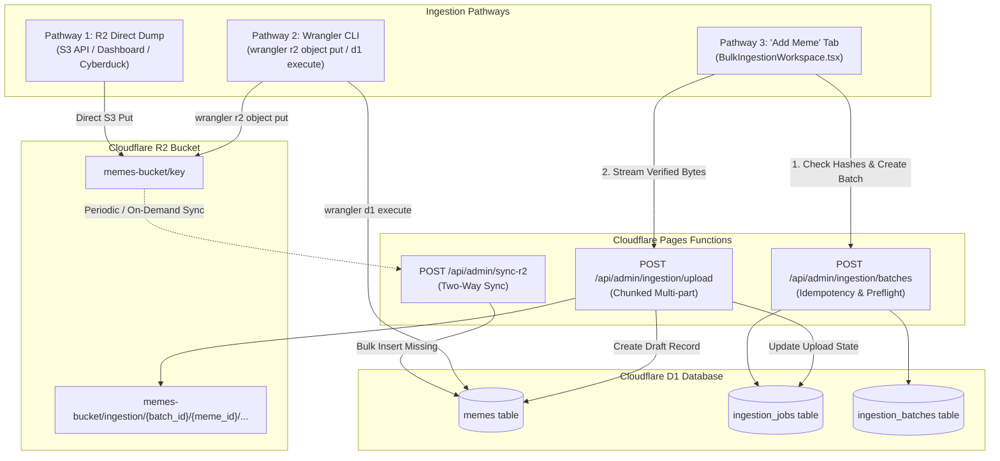
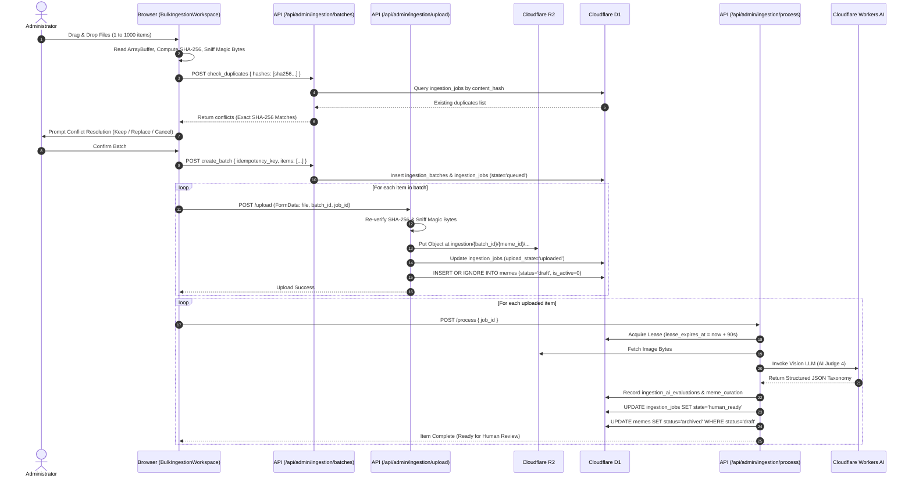
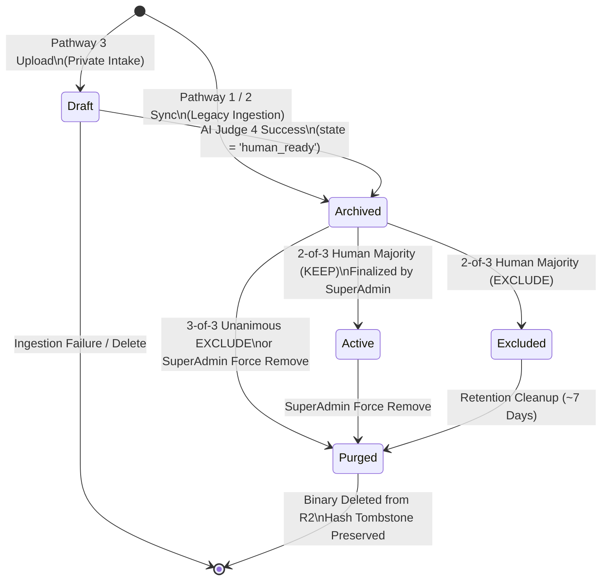
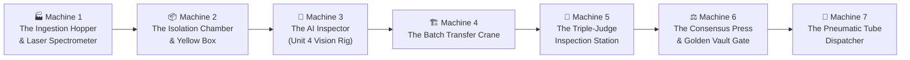

# Meme Capsule — End-to-End Ingestion, Curation & Distribution Architecture

> **Document Version**: 2.0.0  
> **Target Audience**: Core Engineers, System Architects, AI Agents  
> **Repository Scope**: Cloudflare Pages Functions, Cloudflare R2 Storage, Cloudflare D1 Database, Android APK Client Distribution

---

## Executive Summary

The **Meme Capsule** ecosystem is a high-throughput, fault-tolerant media curation and distribution platform designed to ingest raw digital media, classify and normalize it through a hybrid automated AI / human multi-judge pipeline, and serve curated memes with sub-50ms latency to mobile client devices.

This document establishes the authoritative theoretical, mathematical, and logical specification of the system. It covers:
1. The **three ingestion pathways** (R2 Direct Dump, Wrangler CLI, and the Admin "Add Meme" workspace).
2. The **underlying state machine** enforcing the strict **One-Category Rule**.
3. The **mathematical algorithms** governing SHA-256 deduplication, multi-judge majority consensus, and $O(\log N)$ random distribution.
4. An industrial **Conveyor Belt Analogy featuring 7 Specialized Machines** modeling the lifecycle from raw byte ingestion to the APK viewport.

---

## 1. The Three Ingestion Pathways

Memes enter the Meme Capsule infrastructure through three distinct vectors. Each vector handles storage allocation, database synchronization, and state initiation differently.



---

### Pathway 1: Direct Dump Option from R2

The **R2 Direct Dump** pathway occurs when media files are dropped in bulk directly into the Cloudflare R2 bucket (`env.MEMES_BUCKET`) via an external S3-compatible client (Cyberduck, AWS CLI, Cloudflare Dashboard upload, or background sync scripts).

#### Ingestion Characteristics
* **Binary Ingress**: Objects arrive directly in R2 without an active edge worker validating their payload at write time.
* **Database State**: At the moment of upload, the Cloudflare D1 database has **zero awareness** of these files.
* **Reconciliation Mechanism**: Activated when an administrator triggers the **Two-Way Sync** process via `POST /api/admin/sync-r2` ([`functions/api/admin/sync-r2.ts`](file:///c:/Users/avspn/Desktop/projects/meme%20application/functions/api/admin/sync-r2.ts)).

#### Exact Processing Lifecycle
1. **Bucket Traversal**: The edge worker performs paginated cursor listing (`bucket.list({ limit: 1000 })`) up to a protective cap of 50,000 objects.
2. **MIME Extension Filtering**: File extensions are evaluated against an allowlist:
   $$\mathcal{E}_{\text{media}} = \{ \text{.jpg, .jpeg, .png, .gif, .webp, .avif, .svg, .bmp, .mp4, .webm, .mov, .avi, .mkv} \}$$
3. **Corpus Set-Difference Computation**:
   Let $\mathcal{O}_{\text{R2}}$ be the set of valid storage keys in R2, and $\mathcal{D}_{\text{D1}}$ be the set of known keys in D1.
   $$\Delta_{\text{add}} = \mathcal{O}_{\text{R2}} \setminus \mathcal{D}_{\text{D1}}$$
   $$\Delta_{\text{del}} = \{ k \in \mathcal{D}_{\text{D1, R2-backed}} \mid k \notin \mathcal{O}_{\text{R2}} \}$$
4. **Atomic Ingestion Batching**: For every $k \in \Delta_{\text{add}}$:
   - A unique identifier is generated: $UUIDv4()$.
   - The title is synthesized by sanitizing the filename (stripping hyphens, timestamps, and extensions).
   - A record is inserted into `memes` with default attributes:
     - `status = 'archived'`
     - `is_active = 0`
     - `category = 'Synced'`
     - `random_key = Math.random()`
   - Statements are committed in atomic D1 batches of size $B = 50$.
5. **Orphan Purging**: For every $k \in \Delta_{\text{del}}$, the worker cascades deletes across `meme_events`, `meme_analytics`, `meme_daily_stats`, and `memes`.

---

### Pathway 2: Using the Wrangler CLI

The **Wrangler CLI** pathway is an administrative or automated developer ingestion route using Cloudflare's developer tooling.

```bash
# 1. Put binary into R2
npx wrangler r2 object put memes-bucket/uploads/2026/11/rare-pepe.png --file=./rare-pepe.png

# 2. Insert metadata into D1
npx wrangler d1 execute meme-capsule-db --command "INSERT INTO memes (id, title, storage_path, status, is_active, random_key) VALUES ('pepe-001', 'Rare Pepe', 'uploads/2026/11/rare-pepe.png', 'draft', 0, 0.42857);"
```

#### Exact Processing Lifecycle
1. **Decoupled Operations**: Wrangler commands are independent network calls. Uploading to R2 does not touch D1, and executing SQL on D1 does not inspect R2.
2. **Schema Invariant Enforcement**:
   - If an engineer executes an SQL `INSERT` setting `status = 'active'` directly, the D1 row is created, but **the meme will still be rejected by the Random API distribution engine**.
   - **Superadmin Gate**: The distribution query enforces an `INNER JOIN meme_curation_final f ON m.id = f.meme_id WHERE f.corpus_status = 'keep'`. Without an authoritative consensus resolution, the meme remains mathematically unservable.
3. **Reconciliation**:
   - If an asset is placed in R2 without an SQL insert, running `POST /api/admin/sync-r2` discovers it and registers it as `status = 'archived'`.
   - If a row is inserted into D1 pointing to a non-existent R2 key, the next execution of `POST /api/admin/sync-r2` flags it as an orphan and purges it.

---

### Pathway 3: The "Add Meme" Tab (Durable Bulk Ingestion Pipeline)

The **Add Meme** workspace ([`src/admin/BulkIngestionWorkspace.tsx`](file:///c:/Users/avspn/Desktop/projects/meme%20application/src/admin/BulkIngestionWorkspace.tsx)) is the primary production intake portal. It features a multi-stage transactional pipeline that enforces cryptographic hashing, MIME validation, duplicate prevention, and advisory AI pre-evaluation.

#### Exact Step-by-Step Processing



---

## 2. Theoretical & Mathematical Foundations

### 2.1 Cryptographic Identity & Collision Space
Every meme ingested through Pathway 3 is assigned an immutable SHA-256 content digest:
$$H(m) = \text{SHA-256}(\text{Binary}(m)) \in \{0, 1\}^{256}$$

The probability $P$ of a hash collision between two distinct images $m_1 \neq m_2$ across a collection of $N$ items is governed by the generalized birthday bound:
$$P(\text{collision}) \approx 1 - \exp\left( -\frac{N(N - 1)}{2 \times 2^{256}} \right) \approx \frac{N^2}{2^{257}}$$
For a collection size of $N = 10^7$ memes:
$$P(\text{collision}) \approx \frac{10^{14}}{2.31 \times 10^{77}} \approx 4.3 \times 10^{-64}$$
This mathematical guarantee ensures that duplicate detection via `content_hash` has absolute fidelity, allowing instant $O(1)$ index lookups without byte-by-byte visual comparisons.

---

### 2.2 The One-Category Lifecycle State Machine
A meme must exist in **strictly one mutually exclusive lifecycle state** at any instant in time:
$$S(m) \in \{ \text{Draft}, \text{Archived}, \text{Active}, \text{Excluded}, \text{Purged} \}$$



#### State Transition Definitions
1. **Draft ($S = \text{Draft}$)**:
   - Invariants: `memes.status = 'draft'`, `is_active = 0`, `curation_status = NULL`.
   - Visibility: Strictly private. Inaccessible to human judges and public endpoints.
2. **Archived ($S = \text{Archived}$)**:
   - Invariants: `memes.status = 'archived'`, `is_active = 0`.
   - Visibility: Populates the Human Curation Workbenches (`/curate`). Memes are partitioned into batches (`Batch 1` through `Batch N`).
3. **Active ($S = \text{Active}$)**:
   - Invariants: `memes.status = 'active'`, `is_active = 1`, `meme_curation_final.corpus_status = 'keep'`.
   - Visibility: Public. Eligible for retrieval by Android client devices.
4. **Excluded ($S = \text{Excluded}$)**:
   - Invariants: `memes.status = 'archived'`, `is_active = 0`, `meme_curation_final.corpus_status = 'excluded'`.
   - Visibility: Quarantined. Kept in storage for 7 days before hard purge.
5. **Purged ($S = \text{Purged}$)**:
   - Invariants: Row deleted from `memes`, binary deleted from Cloudflare R2, tombstone preserved in `meme_force_removals` (`r2_deleted = 1`).

---

### 2.3 Mathematical Model of Multi-Judge Consensus

The curation consensus engine ([`functions/_shared/curationConsensus.ts`](file:///c:/Users/avspn/Desktop/projects/meme%20application/functions/_shared/curationConsensus.ts)) is a fault-tolerant multi-judge voting protocol.

#### Participants & Weightings
* **Human Judges**: $\mathcal{H} = \{ J_1, J_2, J_3 \}$ (Equal weight $W_h = 1.0$).
* **AI Judge**: $\mathcal{A} = \{ \text{AI Judge 4} \}$ (Advisory weight $W_a = 0.0$; pure fallback).
* **Retired Judges**: Judge 5 has been permanently expunged.

#### 1. Layer-0 Status Resolution
Each human judge $j \in \mathcal{H}$ casts a vote $v_j \in \mathcal{V}$, where:
$$\mathcal{V} = \{ \text{keep}, \text{excluded}, \text{duplicate}, \text{review\_later} \}$$

The status tally function is:
$$C(s) = \sum_{j=1}^3 \mathbb{I}(v_j = s), \quad \text{for } s \in \mathcal{V}$$

The outcome resolution rule is defined as:
$$\text{Status}^* = \begin{cases}
s & \text{if } \exists s \in \mathcal{V} \text{ such that } C(s) \ge 2 \\
\text{Arbitration (Layer-0 Split)} & \text{if } C(s) = 1 \quad \forall s \in \{v_1, v_2, v_3\} \text{ (1:1:1 split)}
\end{cases}$$

#### 2. Unanimous Hard Removal Edge Case
If all three human judges unanimously vote to exclude:
$$\text{Outcome} = \text{Hard Remove (Purge)} \iff C(\text{excluded}) = 3$$
The system immediately queues the meme for binary erasure from R2.

#### 3. Duplicate Target Resolution
If $\text{Status}^* = \text{duplicate}$, let $T_j$ be the duplicate target ID submitted by judge $j$.
$$\text{Target}^* = \begin{cases}
t & \text{if } \sum_{j: v_j=\text{duplicate}} \mathbb{I}(T_j = t) \ge 2 \\
\text{Arbitration} & \text{otherwise}
\end{cases}$$

#### 4. Secondary Taxonomy Resolution (Topics, Tone, Mechanisms)
For multi-value attributes (Topics $\le 3$, Humor Mechanisms $\le 2$), candidate options $o$ are scored by human agreement:
$$S(o) = \sum_{j=1}^3 \mathbb{I}(o \in \text{Selections}_j)$$

Selection filter:
$$\mathcal{O}_{\text{selected}} = \{ o \mid S(o) \ge 2 \}$$

Tie-breaking and fallback logic:
1. If $|\mathcal{O}_{\text{selected}}| > 0$: Sort descending by $S(o)$, breaking ties using the fixed canonical taxonomy order, and take the top $K$ items.
2. If $|\mathcal{O}_{\text{selected}}| = 0$ (no human option achieved majority): **Fallback to AI Judge 4's evaluation**:
   $$\mathcal{O}_{\text{final}} = \text{Selections}_{\text{AI Judge 4}} \cap \text{TaxonomyAllowlist}$$

---

### 2.4 $O(\log N)$ Uniform Random Selection Mathematics

The standard SQL approach `SELECT * FROM memes ORDER BY RANDOM() LIMIT 1` requires a full table scan ($O(N)$ complexity) and generates temporary B-Trees on every mobile pull-down request, causing high CPU and memory thrashing on large datasets.

Meme Capsule implements a **Uniform Spatial Indexing Algorithm**:

1. **Space Allocation**: Each meme $m_i$ is assigned an independent coordinate $K_i$ drawn from the continuous uniform distribution:
   $$K_i \sim \mathcal{U}(0, 1)$$
   This value is indexed in a D1 B-Tree index on `memes(random_key)`.
2. **Runtime Query**: The client request supplies optional filters (e.g. NSFW allowed, exclude recent IDs). The edge worker draws a random probe key:
   $$r \sim \mathcal{U}(0, 1)$$
3. **Primary B-Tree Probe**: The edge worker performs an indexed range scan:
   $$\mathcal{M}_{\text{candidates}} = \sigma_{K \ge r \wedge \text{is\_active}=1 \wedge \text{status}='active'}(memes) \quad \text{LIMIT 5}$$
4. **Circular Wrap-Around**: If $|\mathcal{M}_{\text{candidates}}| < 5$ (which occurs when $r$ is close to the upper boundary $1.0$), the query executes a wrap-around scan from the beginning of the interval:
   $$\mathcal{M}_{\text{wrap}} = \sigma_{K \ge 0 \wedge \text{is\_active}=1 \wedge \text{status}='active'}(memes) \quad \text{LIMIT 5}$$
5. **Selection**: A uniform discrete selection picks one of the candidate items:
   $$m^* \sim \text{Uniform}(\mathcal{M}_{\text{candidates}} \cup \mathcal{M}_{\text{wrap}})$$

#### Complexity Analysis
* **Time Complexity**: $O(\log N)$ to traverse the D1 B-Tree index + $O(1)$ to retrieve 5 rows.
* **Space Complexity**: $O(1)$ memory overhead.
* **Uniformity**: The probability of any meme $m_i$ being selected is proportional to the interval between its key and the predecessor key:
   $$\mathbb{E}[P(m_i)] = \mathbb{E}[K_{(i)} - K_{(i-1)}] = \frac{1}{N_{\text{active}}}$$

---

## 3. The Conveyor Belt Analogy

To intuitively visualize how the entire pipeline functions across systems, imagine an ultra-modern, automated media manufacturing plant. Raw image files travel on high-speed conveyor belts through seven specialized robotic processing machines.



---

### Machine 1: The Ingestion Hopper & Laser Spectrometer
* **Real-World Component**: Pre-flight validation, SHA-256 calculation, MIME sniffer, and Cloudflare R2 binary deposit.
* **The Analogy**:
  Raw crates of memes arrive at the factory dock via three unloading bays:
  - **Bay A (Dump Truck)**: Unloads thousands of unsorted crates directly into the warehouse (R2 Direct Dump).
  - **Bay B (Forklift)**: A technician manually slides specific crates into the racks using CLI levers (Wrangler CLI).
  - **Bay C (Automated Conveyor)**: Administrators drop images into an intake chute ("Add Meme" Tab).
  
  Machine 1 shoots a high-intensity laser spectrometer at each incoming meme. It reads the raw byte headers (Magic Byte Sniffing) to prove the item is a genuine image rather than an executable or corrupt file. It then imprints an indelible laser barcode—the **SHA-256 Content Hash**—onto the chassis. If Machine 1 detects that this exact barcode already exists anywhere in the factory, an alarm sounds, and the duplicate is routed to an administrator for inspection.

---

### Machine 2: The Isolation Chamber & Yellow Tagging System
* **Real-World Component**: Database persistence as `status = 'draft'`, `is_active = 0` in Cloudflare D1.
* **The Analogy**:
  Once validated, the meme is placed into a secure, soundproof **Yellow Box**.
  A yellow warning flag is raised: **DRAFT STATUS**.
  The box is locked inside an opaque isolation room. Even though the meme is physically located on the factory floor, no customer looking through the factory windows (API endpoints) can see it, and no human inspector is allowed to touch it yet. It is completely quarantined.

---

### Machine 3: The Robotic Quality Inspector (Unit 4)
* **Real-World Component**: Vision LLM Advisory Evaluation via Cloudflare Workers AI ([`functions/api/admin/ingestion/process.ts`](file:///c:/Users/avspn/Desktop/projects/meme%20application/functions/api/admin/ingestion/process.ts)).
* **The Analogy**:
  A robotic arm equipped with advanced computer vision—**Unit 4 (AI Judge 4)**—swings over the yellow box.
  Unit 4 examines the visual layout, detects satire, reads the punchline, evaluates cultural tone, and prints an **Advisory Inspection Slip**.
  The slip contains:
  - Recommended disposition: `KEEP`, `EXCLUDE`, or `DUPLICATE`.
  - Detected humor mechanisms: *Absurdity*, *Irony*, *Relatability*.
  - Semantic topics: *Internet Culture*, *Gaming*, *Work*.
  - Confidence rating: e.g., $94\%$.
  
  Unit 4 staples this slip to the outside of the crate. As soon as Unit 4 finishes, it stamps the crate: **HUMAN READY**.

---

### Machine 4: The Batch Transfer Crane
* **Real-World Component**: Automatic state transition from `draft` to `archived` in D1 and batch queue assignment.
* **The Analogy**:
  An overhead gantry crane detects the `HUMAN READY` stamp.
  The crane lifts the crate out of the isolation chamber, strips off the yellow draft flag, and replaces it with an **Orange Transit Tag** (**ARCHIVED STATUS**).
  The crane then sorts the crate into specific, numbered assembly line racks called **Batches** (e.g. `Batch 1`, `Batch 2`, `Batch 28`).

---

### Machine 5: The Triple-Inspector Station
* **Real-World Component**: Human Judge Workbenches (`/curate`), batch queue dropdowns, and strict no-repeat filtering.
* **The Analogy**:
  The crates roll into an observation gallery with three separate, soundproof booths occupied by **Judge 1, Judge 2, and Judge 3**.
  Each judge has their own personal conveyor feed controls:
  - A judge selects a batch tray from their control panel (`📦 Batches Queue`).
  - The crate arrives at their desk. The judge reads Unit 4's advisory slip. On their terminal, they can press Space/Enter to adopt Unit 4's verdict or override it manually.
  - The judge presses their physical embossing seal onto the file: `KEEP`, `EXCLUDE`, `DUPLICATE`, or `REVIEW LATER`.
  - Once stamped, the crate automatically moves away. The system's mechanical teeth ensure **no judge ever receives the same crate twice**.

---

### Machine 6: The Consensus Press & Golden Vault Gate
* **Real-World Component**: Majority Consensus Resolution Engine ([`curationConsensus.ts`](file:///c:/Users/avspn/Desktop/projects/meme%20application/functions/_shared/curationConsensus.ts)) and Finalization Gate.
* **The Analogy**:
  The crate arrives at the heavy hydraulic **Consensus Press**.
  The press reads the embossed seals from the three human inspectors:
  - **Scenario A (Consensus Keep)**: At least 2 judges stamped `KEEP`. The hydraulic press clamps down, permanently etching the record into the **Golden Master Ledger** (`meme_curation_final`). The orange tag is discarded, and a brilliant green neon badge is attached: **ACTIVE STATUS** (`is_active = 1`). The heavy steel doors swing open, and the crate rolls into the **Golden Production Vault**.
  - **Scenario B (Unanimous Exclude)**: All 3 judges stamped `EXCLUDE`. A trapdoor immediately opens under the conveyor belt, dropping the crate directly into the incinerator chute (`hard_remove` purge).
  - **Scenario C (Deadlock Split)**: Judges voted 1 Keep, 1 Exclude, 1 Duplicate. The press stops, a siren flashes, and the crate is diverted to a special siding for the **SuperAdmin Arbiter** to manually resolve.

---

### Machine 7: The Rapid Pneumatic Dispatcher
* **Real-World Component**: The Random Meme Edge API (`/api/random-meme`) using indexed `random_key` lookups.
* **The Analogy**:
  Inside the Golden Production Vault, thousands of active memes sit on a giant revolving circular turntable. Each meme occupies a coordinate between $0.000000$ and $1.000000$ (`random_key`).
  
  Miles away, an Android user opens the Meme Capsule APK on their phone and pulls down to refresh.
  
  Instantly:
  1. An electronic pulse shoots into **Machine 7 (The Pneumatic Dispatcher)**.
  2. The dispatcher generates a random coordinate $r \in [0, 1)$.
  3. A high-speed robotic claw drops onto the revolving turntable at coordinate $r$, grabs the nearest 5 active memes, picks one, and drops it into a pneumatic tube.
  4. The tube shoots the JSON payload and optimized image URL across Cloudflare's global edge network.
  5. In less than 40 milliseconds, the meme materializes in crystal-clear resolution on the user's phone screen.

---

## 4. Architectural Invariant Reference Table

| Layer / Attribute | Draft State | Archived State | Active State | Excluded State | Purged State |
| :--- | :--- | :--- | :--- | :--- | :--- |
| **`memes.status`** | `'draft'` | `'archived'` | `'active'` | `'archived'` | *Record deleted* |
| **`memes.is_active`** | `0` | `0` | `1` | `0` | *Record deleted* |
| **`meme_curation_final`** | *None* | *None* | `corpus_status = 'keep'` | `corpus_status = 'excluded'` | *Record deleted* |
| **R2 Storage Object** | Present (Private) | Present (Private) | Present (Public CDN) | Present (Quarantine) | **Purged from R2** |
| **Human Queue Access** | Ineligible | **Eligible in Batches** | Resolved (Closed) | Resolved (Closed) | Ineligible |
| **APK Distribution** | **Blocked** | **Blocked** | **Eligible (Random API)** | **Blocked** | **Blocked** |

---

## 5. Verification & Testing Standards

To verify the integrity of this architecture in production or staging environments:
1. **Unit Testing**: Run `npm test` to execute the full consensus matrix and queue partition suite ([`tests/curationConsensus.test.mjs`](file:///c:/Users/avspn/Desktop/projects/meme%20application/tests/curationConsensus.test.mjs) and [`tests/aiJudgeQueues.test.ts`](file:///c:/Users/avspn/Desktop/projects/meme%20application/tests/aiJudgeQueues.test.ts)).
2. **Type Safety & Bundle Verification**: Execute `npm run build` to verify strict TypeScript compilation across all edge endpoints and frontend workbenches.
3. **Database Audit**: Verify zero schema drift by comparing table structures against migration definitions in [`d1/migrations/`](file:///c:/Users/avspn/Desktop/projects/meme%20application/d1/migrations/).
